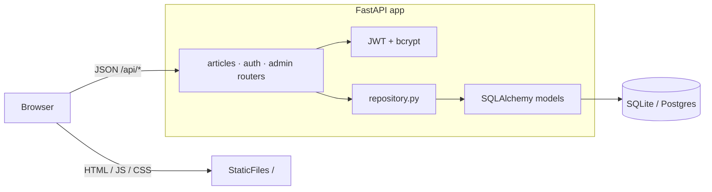

# Psikopedi Blog

A Turkish-language psychology blog: a **FastAPI + SQLAlchemy** REST API with JWT-protected admin endpoints, serving a comic book-styled vanilla JS frontend from the same origin.

[](https://github.com/bcpasaoglu/Psikopedi-blog/actions/workflows/ci.yml)


## Features

- **REST API** for articles with search (`?q=`), pagination (`?limit=&offset=`) and lookup by id or slug
- **Persistent storage** with SQLAlchemy 2.0 (SQLite by default, any SQLAlchemy URL via `DATABASE_URL`)
- **Admin authentication**: username + bcrypt password hash exchanged for a short-lived **JWT** (HS256)
- **Fails closed**: the admin API returns `503` until credentials and a JWT secret are configured
- **Turkish-aware slugs** (`"Kaygı ve Uyku İlişkisi"` → `kaygi-ve-uyku-iliskisi`), unique per article
- **Input validation** with Pydantic (lengths, dates, no `javascript:` image URLs); frontend renders article HTML through DOMPurify
- **Tested**: 33 pytest tests on an isolated SQLite database per test, run in CI on Python 3.11 to 3.13 with Ruff lint/format checks
- **Containerized**: slim, non-root Docker image with a health check, plus a Render Blueprint for one-click deploys

## Architecture



```
backend/
  main.py            # create_app() factory: middleware, routers, static frontend
  config.py          # Settings from env vars / .env (pydantic-settings)
  database.py        # engine, session factory, per-request session dependency
  models.py          # Article ORM model
  schemas.py         # Pydantic request/response models
  repository.py      # queries: list/search/paginate, slug uniqueness
  security.py        # bcrypt verification, JWT issue/verify, admin dependency
  seed.py            # sample articles for an empty database
  hash_password.py   # CLI to generate ADMIN_PASSWORD_HASH
  routers/           # articles.py (public), auth.py, admin.py
frontend/            # index.html, article.html, script.js, style.css (GSAP, DOMPurify)
tests/               # pytest suite
```

The app is built by a factory (`create_app(settings)`), so tests create a fresh app with their own temporary database instead of patching globals.

## API

Interactive docs are available at `/docs` (Swagger UI) when the server is running.

| Method | Endpoint | Auth | Description |
|--------|----------|------|-------------|
| GET | `/api/health` | | Health check |
| GET | `/api/articles?q=&limit=20&offset=0` | | List articles, newest first. Total in `X-Total-Count` |
| GET | `/api/articles/{id_or_slug}` | | Single article |
| POST | `/api/auth/login` | | `{"username", "password"}` → `{"access_token", "token_type", "expires_in"}` |
| GET | `/api/auth/me` | Bearer | Current admin |
| POST | `/api/admin/articles` | Bearer | Create an article (`201`) |
| PATCH | `/api/admin/articles/{id}` | Bearer | Partial update; slug is regenerated when the title changes |
| DELETE | `/api/admin/articles/{id}` | Bearer | Delete an article (`204`) |

Example:

```bash
TOKEN=$(curl -s -X POST localhost:8000/api/auth/login \
  -H 'Content-Type: application/json' \
  -d '{"username":"admin","password":"<your password>"}' | jq -r .access_token)

curl -X POST localhost:8000/api/admin/articles \
  -H "Authorization: Bearer $TOKEN" -H 'Content-Type: application/json' \
  -d '{"title":"Öz Şefkat Nedir?","summary":"Kısa özet","content":"<p>İçerik</p>"}'
```

## Running Locally

```bash
python -m venv .venv && source .venv/bin/activate
pip install -r requirements-dev.txt
cp .env.example .env
python -m backend.hash_password          # paste the output into ADMIN_PASSWORD_HASH
python -c "import secrets; print(secrets.token_urlsafe(48))"   # paste into JWT_SECRET
uvicorn backend.main:app --reload
# open http://localhost:8000
```

Without the admin settings the public site and API work normally; only login and admin endpoints are disabled.

### Docker

```bash
docker build -t psikopedi-blog .
docker run -p 8000:8000 --env-file .env -v psikopedi-data:/app/data psikopedi-blog
```

The SQLite file lives in `/app/data`, so mount a volume to keep data between containers.

## Configuration

| Variable | Default | Description |
|----------|---------|-------------|
| `DATABASE_URL` | `sqlite:///psikopedi.db` | Any SQLAlchemy URL (install the driver, e.g. `psycopg`, for Postgres) |
| `ADMIN_USERNAME` | | Admin login name |
| `ADMIN_PASSWORD_HASH` | | bcrypt hash from `python -m backend.hash_password` |
| `JWT_SECRET` | | Random secret used to sign tokens |
| `JWT_EXPIRE_MINUTES` | `60` | Token lifetime |
| `CORS_ORIGINS` | | Comma-separated origins, only if the frontend is hosted elsewhere |
| `SEED_SAMPLE_DATA` | `true` | Insert sample articles into an empty database |

## Deploying to Render

`render.yaml` is a Render Blueprint: create a new Blueprint from this repository, then set `ADMIN_PASSWORD_HASH` in the dashboard (`JWT_SECRET` is generated automatically). On the free plan the disk is not persistent, so articles reset to the sample data on each deploy; attach a Render disk at `/app/data` or point `DATABASE_URL` at a Postgres database for permanent storage.

## Tests

```bash
pytest            # 33 tests
ruff check . && ruff format --check .
```

The suite covers public endpoints, search and pagination, persistence across app restarts, login, expired/forged/unsigned tokens, fail-closed configuration, CRUD, slug uniqueness and input validation.

## Roadmap

- [x] SQLite persistence with SQLAlchemy
- [x] JWT admin authentication
- [x] Search and pagination
- [x] Docker image and Render deploy config
- [ ] Admin panel UI on top of the JWT API
- [ ] Alembic migrations
- [ ] Categories and tags

## License

MIT
