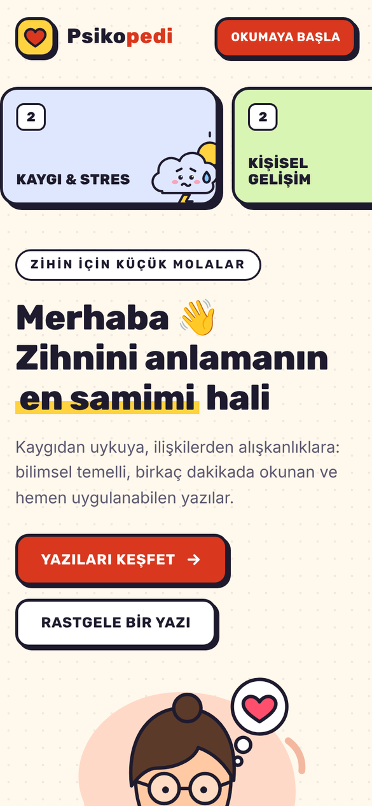
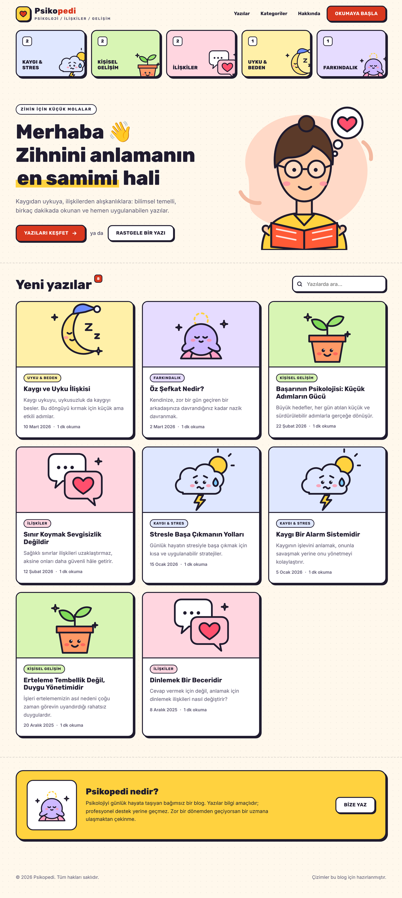
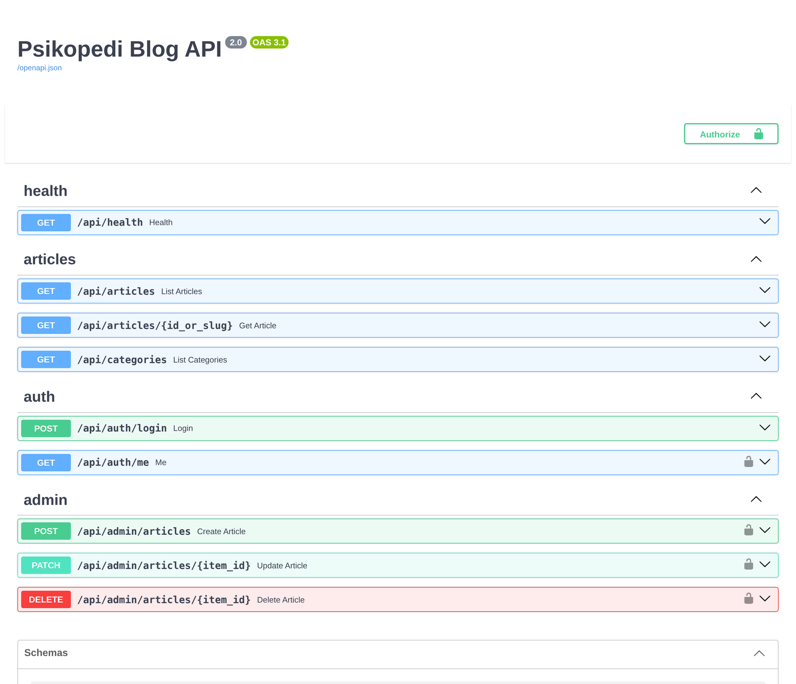
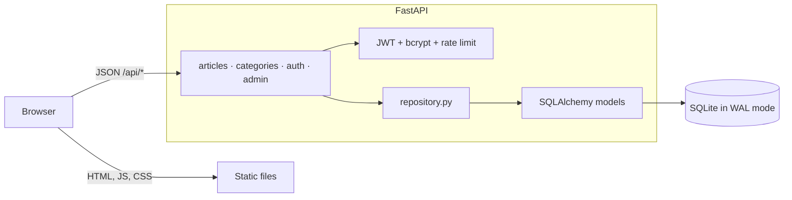

# Psikopedi

A Turkish psychology blog with a FastAPI backend and a hand-drawn, comic-style frontend. Readers browse short articles by category; a single admin writes them through a JWT-protected API.

[](https://github.com/bcpasaoglu/Psikopedi-blog/actions/workflows/ci.yml)


[](LICENSE)


## Why I built this

I took Psikopedi on as volunteer freelance work, mostly to get real experience. The goal was to build a blog from scratch and then improve its security and usability one step at a time. The git history follows that path: first a site that works, then an admin API that fails closed, then a real database, tests and CI, then login rate limiting, security headers and a load test, and finally a redesign that is pleasant to read on a phone.

## What it does

- Lists articles newest first, with search, pagination and a filter per category
- Shows five categories with live article counts; clicking one filters the list
- Renders each article with reading time and related posts from the same category
- Lets one admin log in with a bcrypt-hashed password and get a short-lived JWT
- Gives the admin create, partial update and delete endpoints; slugs are generated from Turkish titles (`Kaygı ve Uyku İlişkisi` becomes `kaygi-ve-uyku-iliskisi`) and kept unique
- Locks the admin API (503) until credentials are configured, and slows down password guessing with a per-IP limit on failed logins
- Sends a Content-Security-Policy and the usual security headers on every page
- Works on phones: the category cards turn into a swipeable strip

## Screenshots

| Home | Article | Phone |
|---|---|---|
|  |  |  |

<details>
<summary>More: mobile demo, full home page, API docs</summary>






</details>

The illustrations (the reader, the worried cloud, the sprout, the sleepy moon and friends) are SVGs drawn for this project in `frontend/illustrations.js`. Articles without a cover image use their category's drawing, so the site needs no image host.

## How it fits together



One process serves both the API and the frontend, so there is no CORS setup and nothing to build: the frontend is plain ES modules.

**Stack:** Python, FastAPI, SQLAlchemy 2, Pydantic, PyJWT, bcrypt, SQLite · vanilla JavaScript, GSAP for small animations, DOMPurify for article HTML · pytest, Ruff, GitHub Actions, Docker, Render

```
backend/
  main.py           app factory: middleware, routers, static frontend
  routers/          articles.py (public), auth.py, admin.py
  repository.py     queries: search, filters, pagination, slug uniqueness
  security.py       bcrypt check, JWT issue and verify
  ratelimit.py      failed-login limiter
  headers.py        CSP and security headers
  database.py       engine, sessions, small column migration
  models.py, schemas.py, categories.py, seed.py, config.py
frontend/
  index.html, article.html, home.js, article.js, app.js
  illustrations.js  the drawings
  style.css         the comic theme
scripts/load_test.py
tests/
```

## Running it

With Docker, one command:

```bash
docker compose up --build
# http://localhost:8000
```

The site and public API work right away with sample articles. To enable the admin API, copy `.env.example` to `.env`, fill in the three admin values (below) and run the command again.

Without Docker:

```bash
python -m venv .venv && source .venv/bin/activate
pip install -r requirements-dev.txt
cp .env.example .env
python -m backend.hash_password                                 # -> ADMIN_PASSWORD_HASH
python -c "import secrets; print(secrets.token_urlsafe(48))"    # -> JWT_SECRET
uvicorn backend.main:app --reload
```

Writing an article from the command line:

```bash
TOKEN=$(curl -s -X POST localhost:8000/api/auth/login \
  -H 'Content-Type: application/json' \
  -d '{"username":"admin","password":"<your password>"}' | jq -r .access_token)

curl -X POST localhost:8000/api/admin/articles \
  -H "Authorization: Bearer $TOKEN" -H 'Content-Type: application/json' \
  -d '{"title":"Öz Şefkat Nedir?","category":"farkindalik","content":"<p>...</p>"}'
```

The full API is documented at `/docs` while the server runs.

| Method | Endpoint | Auth | |
|---|---|---|---|
| GET | `/api/articles?q=&category=&limit=&offset=` | | List, total in `X-Total-Count` |
| GET | `/api/articles/{id_or_slug}` | | One article, with `reading_minutes` |
| GET | `/api/categories` | | Categories with counts |
| POST | `/api/auth/login` | | Username and password to JWT |
| POST | `/api/admin/articles` | Bearer | Create |
| PATCH | `/api/admin/articles/{id}` | Bearer | Partial update |
| DELETE | `/api/admin/articles/{id}` | Bearer | Delete |

<details>
<summary>Configuration</summary>

| Variable | Default | |
|---|---|---|
| `DATABASE_URL` | `sqlite:///psikopedi.db` | Any SQLAlchemy URL |
| `ADMIN_USERNAME` | | Admin login name |
| `ADMIN_PASSWORD_HASH` | | From `python -m backend.hash_password` |
| `JWT_SECRET` | | Random string that signs tokens |
| `JWT_EXPIRE_MINUTES` | `60` | Token lifetime |
| `LOGIN_MAX_ATTEMPTS` / `LOGIN_WINDOW_SECONDS` | `5` / `300` | Failed logins allowed per IP |
| `ENABLE_HSTS` | `false` | Turn on behind HTTPS |
| `FORWARDED_ALLOW_IPS` | `127.0.0.1` | Proxies whose `X-Forwarded-For` is trusted |
| `CORS_ORIGINS` | | Only if the frontend is hosted elsewhere |
| `SEED_SAMPLE_DATA` | `true` | Sample articles for an empty database |

</details>

**Deploying:** `render.yaml` is a Render Blueprint. Create a Blueprint from the repo and set `ADMIN_PASSWORD_HASH` in the dashboard; the JWT secret is generated for you.

**Tests:** `pytest` runs 43 tests, each against its own temporary database. CI also runs Ruff, the suite on Python 3.11 to 3.13, a Docker build with a smoke test, and a load test at 100 concurrent requests.

## Technical decisions

**SQLite instead of Postgres.** One writer (the admin) and many readers is exactly what SQLite handles well, and WAL mode lets reads continue during a write. It keeps the project to a single container. Everything goes through SQLAlchemy, so moving to Postgres is a `DATABASE_URL` change.

**One admin from environment variables instead of a users table.** The blog has one author. A users table would mean registration, password resets and roles that nothing uses yet. The admin's password is stored only as a bcrypt hash, and the API stays closed until it is set.

**Short-lived JWTs.** The admin API is stateless, so any instance can verify a token without a session store. Tokens expire after an hour; the trade-off is that there is no server-side logout.

**A load test in CI.** An early version deadlocked at about 100 concurrent requests: sync endpoints held their database connection while waiting for a worker thread to serialize the response. Read endpoints now end their transaction before returning, and the CI load test fails on any error so the problem cannot come back silently.

## Known limitations

- Rate limiting lives in process memory, so it only works with a single instance.
- On Render's free plan the disk is wiped on every deploy; articles return to the samples unless you attach a disk or use Postgres.
- There is no admin panel yet; writing happens through the API.
- Logging out does not revoke a token; it simply expires.
- Schema changes beyond adding columns would need a real migration tool such as Alembic.

Next up: an admin panel on top of the existing API, Alembic migrations, and tags.

## License

MIT
